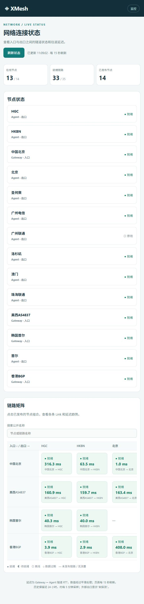
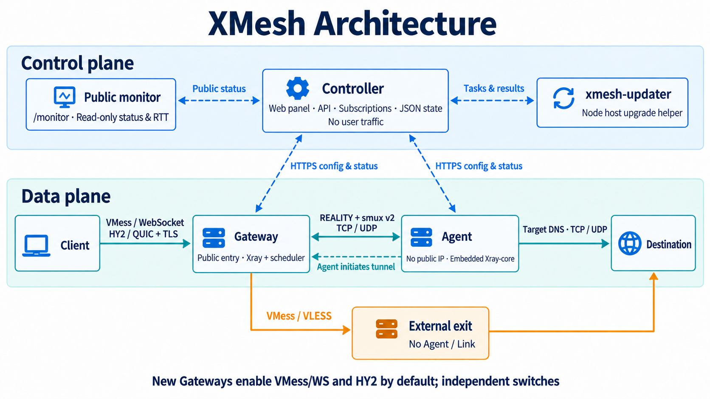
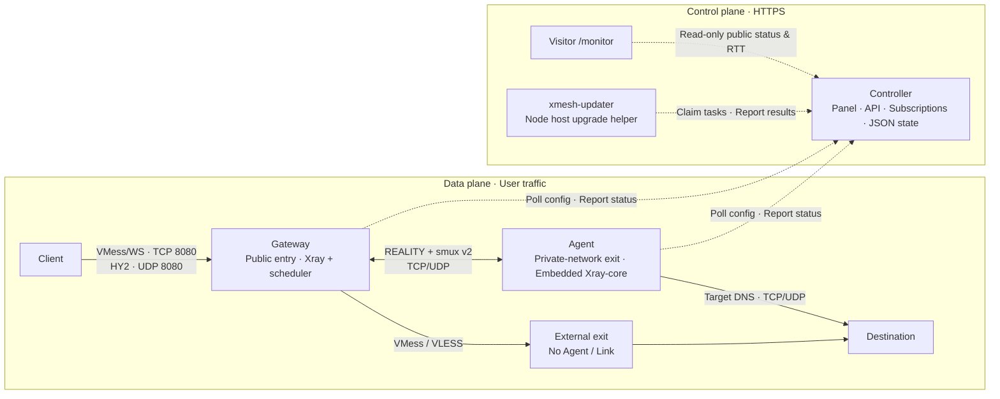

# XMesh

[简体中文](README.md) · [Public monitor](https://xmesh.static.win7.win/monitor) · [Download releases](https://github.com/Purestreams/xmesh/releases) · [Panel guide](docs/panel.md) · [Deployment and maintenance](docs/automation.md)

**Use a machine without a public IP as your proxy exit.**

XMesh separates the client entry point from the actual exit. A reachable Gateway accepts clients; an Agent initiates a tunnel from its private network to the Gateway and accesses destinations through its own network. The Controller manages nodes, routes, user access and subscriptions without carrying user traffic.

Use it when an exit machine sits behind NAT, cannot accept inbound connections, or needs to serve several Gateways. The Gateway must remain reachable by both clients and the Agent. The Agent needs neither a public IP nor inbound port forwarding.

## Public monitor

[Open the network monitor →](https://xmesh.static.win7.win/monitor)

View published node states, the Gateway × exit matrix, individual Link RTT and 24-hour trends without signing in. The page refreshes every 15 seconds; history is sampled about every five minutes. Latency means **Gateway ↔ Agent tunnel RTT**. Client-to-Gateway latency and complete proxy request time require separate tests. External routes are tested by their corresponding Gateway through the selected upstream against ip.sb and microsoft.com. Public external latency is the IP.SB HTTPS request time; routes without completed tests remain unprobed.

Public monitoring is disabled by default on a self-hosted Controller. Enable it under **系统维护 → 公开监控** (`/admin/monitor`), select nodes and Links, and assign public aliases. Visitors use `/monitor` and the dedicated read-only `/api/public/monitor` endpoint. The public response exposes only aliases, roles, coarse states and RTT history; it excludes real addresses, internal identities, credentials, users, usage and raw errors. See the [public monitor guide](docs/panel.md#anonymous-network-monitor).

<details>
<summary>Monitor preview (captured 2026-10-13; open the live page for current status)</summary>

[](https://xmesh.static.win7.win/monitor)

</details>

## Architecture at a glance



<details>
<summary>View the maintainable diagram source</summary>

Image prompts are saved in the [architecture image generation record](docs/assets/architecture-prompts.md).



</details>

- **Client entry:** New Gateways enable VMess/WebSocket and Hysteria 2 (HY2) by default. The same Xray process accepts both and routes traffic by Grant; each protocol has an independent switch.
- **Agent exit:** The Agent initiates a VLESS/REALITY connection carrying WebSocket + smux v2. The Gateway schedules TCP/UDP sessions onto authorized Links; the Agent resolves destination DNS and opens outbound connections.
- **External exit:** The Gateway can also forward authorized traffic to a selected VMess or VLESS upstream. This route requires no Agent or Link.
- **Network requirements:** Clients and Agents must reach the Gateway; nodes and upgrade helpers must reach the Controller. Agents need neither public IPs nor inbound port forwarding. Diagram ports are defaults.
- **Control plane:** The Controller embeds the management panel, public monitor, API, subscriptions and release cache, with JSON-file persistence and no separate frontend or database. Gateways, Agents and upgrade helpers initiate HTTPS requests; the Controller never forwards user traffic.

Configuration updates follow their runtime impact: metadata changes keep connections, while priority, weight and stream limits govern new sessions. Tunnel address or credential changes rebuild the affected Agent Link. A changed generated Gateway Xray configuration can still restart Xray and interrupt connections. Node configuration leases expire after five minutes without renewal, closing user traffic. See [runtime boundaries](docs/deployment.md#runtime-boundaries) and [architecture details](docs/architecture.md).

Client proxy traffic blocks destination TCP ports `25, 465, 587, 2525` by default across VMess/WS, HY2, Agent exits and external exits. An Agent port allow list cannot override this rule. UDP and the nodes' own management/tunnel connections are unaffected. This reduces common SMTP abuse; HTTPS webmail, email APIs and custom ports remain available. Existing deployments must upgrade their Gateways and Agents to apply the policy.

## Capabilities

Per-user auditing is off by default. Enable it under **Users & subscriptions → User audit** to collect Agent DNS resolution and TCP connection metadata. All exits share one user log store with a default 20MB limit including gzip archives. The page shows 60-second connection, failure, target and port indicators. External exits are not covered and alerts never block users automatically. See [per-user audit](docs/panel.md#per-user-audit).

| Capability | Behavior |
| --- | --- |
| Central management | Embedded web panel with overview, network, users and subscriptions, deployment and maintenance; no separate frontend service |
| Multiple entries and exits | Many-to-many Gateway–Agent assignments, bulk binding and filtering/enabling inactive connections across nodes |
| Dual-protocol entry | Independent VMess/WS and HY2 switches; persistent self-signed HY2 certificates, SHA-256 pins and strict-verification client bundles |
| TCP / UDP forwarding | VMess/WS or HY2 entry routes to an authorized Agent or external exit; Agent destination DNS and outbound connections obey allowed and denied CIDRs |
| REALITY tunnels | Generated Gateway keys and Link identities; embedded Xray-core on the Agent and a bundled, supervised Xray process on the Gateway |
| Multiple Links | Priority, weight, connection count and stream capacity; new sessions select healthy paths while existing sessions stay on their original tunnel |
| Access and subscriptions | Per-user, per-route grants; VMess / HY2 entries publish after Gateway acknowledgement and ingress readiness; disable grants or reset subscription and proxy credentials |
| External exits | Import a `vmess://` or `vless://` link, or explicitly select one subscription node; VMess/TCP, VMess/WS with optional TLS, and VLESS/TCP + REALITY + Vision |
| Deployment and maintenance | One-time enrollment tokens, systemd / Docker Compose commands, release caching, host upgrade helpers and credential rotation; serial upgrades wait for Link recovery |
| Status and history | Topology, Gateway × Agent matrix, deployment progress, 15-second partial refresh, 24-hour Link history and the latest 100 management request results |
| Public monitor | Optional anonymous read-only page with selected public aliases, node/Link states and RTT history |

New routes use `reality://`. Existing `wss://` Links remain supported with external TLS termination. VMess/WS uses **TLS off** by default; new Gateways also enable HY2 with a self-signed certificate and SHA-256 pin. REALITY encryption between Gateway and Agent does not enable TLS on the VMess entry. The current VMess subscription generator has no client TLS setting, so adding an HTTPS reverse proxy alone will not make the generated subscription match it.

## Four objects to know

| Object | Meaning |
| --- | --- |
| Gateway / Agent | The client entry and actual exit, installed and reporting status independently |
| Node / route association (Attachment) | One `Gateway × (Agent or external exit)` pair: the unit used for access grants and subscription entries |
| Link | A transport path for a Gateway–Agent pair; adding Links does not add subscription entries, and external exits have no Links |
| Grant | One `User × Node` authorization with separate VMess UUID, HY2 and loopback SOCKS credentials |

One Agent can initiate connections to several Gateways, and one Gateway can use several Agents through separate routes. Link scheduling applies to new TCP connections or UDP associations. It neither migrates existing sessions nor splits one session across multiple Links.

## Deployment

This walkthrough uses three separate Linux hosts for Controller, Gateway and Agent. The systemd installers support Debian/Ubuntu and CentOS 7/8 on amd64 and arm64; CentOS 7 automatically uses service settings compatible with systemd 219. The Docker installer supports Linux amd64 and arm64, requires Docker Engine with the Compose plugin, and uses host networking. Windows amd64 releases contain only a standalone executable, without a Windows service installer or bundled Xray.

Choose one installation method per role on a host. The systemd installers use fixed service names and paths; deploy the Controller separately from nodes.

### 1. Prepare networking and installation files

These ports match the default configuration:

| Host | Example address | Inbound ports | Purpose |
| --- | --- | --- | --- |
| Controller | `panel.example.com` | TCP 80 / 443 | 80 handles ACME validation and redirects below; 443 serves the panel, node API, subscriptions and installation files |
| Gateway | `edge.example.com` or a public IP | TCP 8080 / 8443, UDP 8080 | TCP 8080 accepts VMess/WS, UDP 8080 accepts HY2; 8443 accepts Agent REALITY tunnels |
| Agent | No public address required | None required | Needs outbound access to Controller, Gateway and proxy destinations |

Keep Controller `127.0.0.1:8088`, Gateway SOCKS `127.0.0.1:18080` and tunnel backend `127.0.0.1:18081` local. Gateway REALITY needs neither a certificate for `edge.example.com` nor Nginx. A different public port requires matching firewall rules, a listener or port mapping, and the Link URL; changing the URL alone does not change the host listener.

Replace the example names with your own addresses and configure DNS. Install the base tools on all three Debian/Ubuntu hosts:

```sh
sudo apt update
sudo apt install -y ca-certificates curl tar coreutils
```

On CentOS hosts, prepare the base tools below with working yum/dnf repositories, then use the same systemd installation commands:

```sh
# CentOS 7
sudo yum install -y ca-certificates curl tar coreutils iproute shadow-utils
# CentOS 8
sudo dnf install -y ca-certificates curl tar coreutils iproute shadow-utils
```

If firewalld is enabled on the Gateway, allow the VMess and REALITY TCP ports in the zone used by its network interface. For `--vmess-port 8086`, allow TCP 8086 and 8443; Agents need no inbound ports. The Nginx/Certbot package commands and paths below target Debian/Ubuntu. On a CentOS Controller, configure the HTTPS reverse proxy for its repositories, Nginx layout and SELinux policy.

On the Controller host only, install these additional tools and obtain the source. This README describes the current code; the installation example pins release `v0.4.0`. To use another published version, set `VERSION` to its exact tag and use matching source and release assets. See [Releases](https://github.com/Purestreams/xmesh/releases) for available versions.

```sh
sudo apt install -y git nginx certbot
VERSION=v0.4.0
git clone --depth 1 --branch "$VERSION" https://github.com/Purestreams/xmesh.git
cd xmesh
```

### 2. Install the Controller

Run this in Bash on the Controller host. Install Docker Engine and the Compose plugin first if choosing Docker. Run only one of the two installation commands.

```bash
read -rsp 'Admin password: ' XMESH_ADMIN_PASSWORD; echo
export XMESH_ADMIN_PASSWORD

# systemd
sudo --preserve-env=XMESH_ADMIN_PASSWORD sh scripts/install-controller.sh \
  --version "$VERSION" --public-url https://panel.example.com

# Or Docker Compose
# sudo --preserve-env=XMESH_ADMIN_PASSWORD sh scripts/install-docker.sh \
#   --role controller --version "$VERSION" --public-url https://panel.example.com

unset XMESH_ADMIN_PASSWORD
```

The default administrator is `admin`; use `--admin-username` on the initial installation to choose another name. The installer downloads the architecture-specific archive, verifies `SHA256SUMS`, generates the password hash and session secret, and checks service health after startup.

### 3. Enable HTTPS for the Controller

The Controller itself serves HTTP only. Create an ACME validation site first, obtain the certificate, then enable HTTPS:

```sh
DOMAIN=panel.example.com
sudo mkdir -p /var/www/letsencrypt
printf 'server { listen 80; server_name %s; location ^~ /.well-known/acme-challenge/ { root /var/www/letsencrypt; } location / { return 404; } }\n' "$DOMAIN" | sudo tee /etc/nginx/conf.d/xmesh.conf
sudo nginx -t && sudo systemctl reload nginx
sudo certbot certonly --webroot -w /var/www/letsencrypt -d "$DOMAIN"
```

Replace `/etc/nginx/conf.d/xmesh.conf` with the configuration below. The hostname and certificate paths must match `--public-url`:

```nginx
server {
    listen 80;
    server_name panel.example.com;
    location ^~ /.well-known/acme-challenge/ { root /var/www/letsencrypt; }
    location / { return 301 https://$host$request_uri; }
}
server {
    listen 443 ssl;
    server_name panel.example.com;
    ssl_certificate /etc/letsencrypt/live/panel.example.com/fullchain.pem;
    ssl_certificate_key /etc/letsencrypt/live/panel.example.com/privkey.pem;

    proxy_set_header Host $host;
    proxy_set_header X-Forwarded-Proto $scheme;
    proxy_set_header X-Real-IP $remote_addr;

    location ^~ /subscription/ {
        access_log off;
        proxy_pass http://127.0.0.1:8088;
    }
    location ^~ /releases/ {
        proxy_read_timeout 600s;
        proxy_buffering off;
        proxy_pass http://127.0.0.1:8088;
    }
    location / {
        proxy_pass http://127.0.0.1:8088;
    }
}
```

Subscription URLs contain bearer tokens, so access logging is disabled for `/subscription/`; any outer proxy should also avoid logging complete subscription URLs. The first `/releases/` request may wait for the Controller to download and verify an asset from GitHub, so this location has a longer proxy read timeout and disables response buffering.

```sh
sudo nginx -t && sudo systemctl reload nginx
printf '#!/bin/sh\nsystemctl reload nginx\n' | sudo tee /etc/letsencrypt/renewal-hooks/deploy/reload-nginx.sh
sudo chmod 755 /etc/letsencrypt/renewal-hooks/deploy/reload-nginx.sh
sudo certbot renew --dry-run
curl -fsS https://panel.example.com/healthz
```

The health check should return `{"status":"ok"}`. Sign in at `https://panel.example.com/login`.

### 4. Create a route in the deployment wizard

For the first deployment, **Create route** creates a Gateway, Agent, Node association and Link in one operation:

| Field | Example or meaning |
| --- | --- |
| Gateway public host | `edge.example.com` or a public IP, without a scheme or path |
| Gateway location | Select China mainland or overseas to choose the default for a new REALITY target |
| VMess port / WS path | Defaults to `8080` / `/proxy`, used by clients |
| Agent allowed / denied CIDRs | Controls reachable destination addresses; defaults to allowing `0.0.0.0/0, ::/0`, which you can narrow or supplement with denied ranges |
| Agent → Gateway Link URL | `reality://edge.example.com:8443/tunnel`, used by the Agent |
| REALITY target | A TLS destination reachable from the Gateway; must be a DNS hostname followed by `:443` |

For a new target, China mainland defaults to `api.bilibili.com:443` and overseas to `www.swift.com:443`. These are configuration defaults, not proof of availability in your network: check TLS 1.3 support and the target's certificate name during deployment. If no location or existing target is set, enter a target manually. The Gateway address in the Link URL and the target's TLS name are separate fields.

Each Gateway shares one REALITY key pair and target; each Link has a separate VLESS UUID and short ID generated by the Controller. **Changing the Gateway location does not replace an existing target.** Explicitly changing the shared target in the Link editor affects all REALITY Links on that Gateway.

You can also create nodes separately in the network section, then use **Assign multiple Gateways to an Agent**. Missing associations and Links are created together, disabled routes are re-enabled, and active routes are left unchanged. For mixed-region assignments, a blank target resolves from each Gateway's location while existing targets take precedence.

Under **连接已有节点 → 全部未开启连接**, filter missing, disabled or Link-less pairs across Agents and Gateways, then enable the selected pairs in one transaction. Enabled pairs stay excluded even when offline. Existing targets and Link settings are preserved; user grants remain a separate action.

### 5. Install the Gateway and Agent

Click **Install Gateway** and **Install Agent** separately, choose systemd or Docker Compose, run each generated command on its corresponding host, and enter that node's one-time token at the prompt. Node hosts do not need a repository checkout.

- Tokens expire after 30 minutes and can be used once. Issuing a new token for the same node revokes its previous unused token.
- Choose direct GitHub downloads or the Controller cache. Caching still requires GitHub access from the Controller, and files enter the cache only after successful verification.
- Generated commands pin a version and verify the installation script; the installer then verifies the binary archive. A custom VMess port is passed through `--vmess-port` for the installer's port check.
- The panel generates commands; it does not install over SSH. Docker uses host networking and needs no additional Compose port mapping.

Follow enrollment, heartbeat, applied configuration and runtime status in the deployment progress view. An `online` node alone does not establish a usable route.

### 6. Grant access and import the subscription

New Gateways enable both **VMess/WS and HY2** by default. The Gateway list and edit form provide independent switches. Disabling a protocol removes its listener and subscription entries; re-enabling preserves credentials, the certificate and pin. The Agent tunnel remains available when both protocols are off. Existing Gateways retain their settings. Multiple users and routes share one UDP listener with separate Grant credentials; VMess TCP and HY2 UDP may use the same port number. HY2 uses a persistent self-signed certificate and SHA-256 pin. Unauthenticated HTTP/3 requests always return a static 404. See [HY2 details](docs/hy2.md) for strict client verification, UDP firewall rules and acceptance checks.

Create a User under users and subscriptions, then select that user and the permitted routes in the subscription grant form. This creates or re-enables Grants. Clearing the selection only clears the form; disable or delete Grants separately to revoke access.

A Grant publishes after the Gateway reports the corresponding configuration applied and the relevant ingress ready. Copy the subscription URL into a client supporting the selected protocols. The response is a Base64-encoded list of enabled, ready `vmess://` and `hysteria2://` entries. VMess clients connect to `edge.example.com:8080/proxy`, HY2 uses UDP 8080, and the Agent tunnel uses TCP 8443. For the official Hysteria client, download the strict-verification client bundle from Grant management to configure public certificate trust and the pin; see [HY2 details](docs/hy2.md).

**Subscription publication is separate from route health.** For an Agent route, check that both nodes are online with their configuration applied, Gateway Xray is ready, and the same enabled Link reports ready at both Gateway and Agent. Then test actual destination access. For an external exit, confirm Gateway configuration acknowledgement and test upstream and destination connectivity.

Add an external exit under **节点与线路 → 外部出口** using a VMess/TCP or VMess/WS link with optional TLS, a VLESS/TCP + REALITY + Vision link, or a subscription URL. Select one supported node explicitly, bind it to a Gateway and grant user access. The Controller refreshes subscriptions every 30 minutes, with manual refresh available. Failed fetches retain the last valid endpoint; a successful refresh that loses the selected node disables the exit. Upgrade older Gateways before using this route. After applying configuration, the Gateway automatically tests ip.sb and microsoft.com through that upstream and repeats every five minutes by default. The panel provides a Test connection button, per-site results, HTTPS timing, exit IP and errors. Tests are independent of user grants, do not count toward user usage, and do not restart Xray. Upgrade both Controller and Gateway to enable testing. User subscriptions contain neither the upstream subscription URL nor its UUID. Private subscription sources require the explicit Controller setting `allow_private_upstream_sources`.

## Operations

### Configuration, state and logs

| Installation | Configuration | State / data | Logs |
| --- | --- | --- | --- |
| systemd Controller | `/etc/xmesh/controller.json` | `/var/lib/xmesh-controller/` | `sudo journalctl -u xmesh-controller -f` |
| systemd Gateway / Agent | `/etc/xmesh/node.json` | `/var/lib/xmesh/` | `sudo journalctl -u xmesh -f` |
| Docker, default paths | `/opt/xmesh-docker-<role>/config/` | `/opt/xmesh-docker-<role>/data/` | Run `sudo docker compose logs -f` from that installation directory |

Controller state lives in `controller-state.json`; no separate database is required. Configuration, state and backups contain credentials or private keys and need restricted access. Do not commit them, enrollment tokens or subscription URLs.

The panel refreshes status every 15 seconds while preserving inputs. Link history comes from Gateway reports, sampled at most every five minutes and retained for 24 hours. Restarts, counter resets and long sampling gaps leave missing throughput points. Users and subscriptions show per-user upload/download for the last 5 hours, day, 7 days and 30 days, with a per-Link breakdown. The Gateway attributes TCP/UDP payload bytes to the selected Link; older versions did not retain this attribution, so usage starts accumulating after upgrade. Five-minute buckets are retained for 30 days. The latest 100 management request results are stored with Controller state; accepting an upgrade request and completing an upgrade are displayed separately.

### Upgrades, rotation and backups

The v0.3.3 release contains `xmesh-updater` for panel-issued node upgrades. v0.3.2 does not contain this helper. When migrating older installations, upgrade the Controller first, then install the helper on older nodes.

- **Upgrade the Controller before Gateways and Agents.** Controller installers preserve existing settings and update `release_version`. Passing `--public-url` or an administrator password again does not overwrite the existing configuration. Older configurations missing `release_dir` need that field added manually and a restart to enable caching.
- A Docker Controller can check GitHub's latest stable release and upgrade from the panel when the host has systemd, `flock`, `sort` and the updater helper. The host helper verifies assets, backs up and performs the upgrade; the Controller container has no Docker socket mount. Older installations first need a host-side run of a Docker installer that provides the helper.
- Upgrade a systemd Controller with the matching release's `install-controller.sh`. New Gateway / Agent installations configure an independent host `xmesh-updater` service. In **System maintenance → Node upgrades**, select a fixed version and nodes; the helper claims tasks, verifies assets, checks the new process and configuration, and restores the old version on failure. Batch tasks run serially and pause when a previously healthy Link degrades.
- After each successful node upgrade, the batch enters `recovering` for up to two minutes. Previously healthy Links must have fresh online, ready reports from both Gateway and Agent received since upgrade completion before the next task can start. On timeout, fix the Link and use **重新检查并继续** to recheck recovery and release the remaining tasks without repeating successful upgrades.
- For an older node, generate a one-time helper pairing token in **Node upgrades** and run the panel's verified `install-updater.sh` command on that node host. The one-time token is included in the command, so there is no second prompt; the node identity is preserved. The copied command contains a secret, so clear it from shell history after use. Manual upgrade commands on paired nodes use the same host helper executor; unpaired nodes retain the original installer path. Docker nodes require systemd on the host for the helper; the business container has no Docker socket mount.
- Upgrade history is stored in Controller state. Keep unfinished host job records and rollback material in `/var/lib/xmesh-updater/jobs` (systemd) or `updater/jobs` under the Docker installation directory when backing up or cleaning up.
- Rotate node credentials with a new enrollment token and the panel's **rotate** command, preserving node identity. The old credential has up to 15 minutes of grace and is revoked on the first status report using the new credential. For a leaked subscription, **Reset link** immediately invalidates the URL and rotates VMess, HY2 and SOCKS credentials for all that user's routes. Gateways revoke old proxy credentials when they apply the change; clients must import the new subscription.
- Deleting a Gateway / Agent in the panel removes related management objects but does not remotely uninstall its service. Stop or uninstall the service on the corresponding host.

For a Docker Controller, run this from a matching source checkout:

```sh
sudo sh scripts/backup-controller.sh \
  /opt/xmesh-docker-controller /var/backups/xmesh-controller
```

The script archives configuration and any existing state file, extracts and compares them, and generates a SHA-256 checksum file. Keep both the archive and checksum off-host. For systemd deployments, back up the configuration and state files listed above. Restore is manual and should first be tested in an isolated environment. See [deployment automation](docs/automation.md) for details.

### Troubleshooting order

| Symptom | Check first |
| --- | --- |
| Installation or enrollment fails | Controller HTTPS `/healthz`, system time, expired or replaced tokens; regenerate commands for a custom Gateway port |
| Node is online but route is pending | Desired / applied configuration on both nodes, ApplyError, Gateway Xray and both reports for the same Link |
| REALITY Link cannot connect | Gateway TCP 8443, firewall/mapping, Link URL versus actual listener, and Gateway access to the target |
| Empty subscription or missing new route | Enabled User / Grant / Node and ingress protocol, plus Gateway configuration acknowledgement and ingress readiness; Agent routes also need an enabled Link |
| Subscription contains a route but access fails | Actual Link health, Agent outbound network, DNS and CIDR policy |
| Release cache returns errors | Controller access to GitHub, `release_version` / `release_dir`, disk space and proxy timeouts; use a direct GitHub command if needed |
| Low throughput at high RTT | Host TCP buffers and Link write stalls, capacity and rejection counters; see [high-latency links](docs/deployment.md#high-latency-links) |

## Development and verification

XMesh is written in Go. `mise.toml` pins Go **1.27.2**; `versions.env` pins the external Gateway Xray version, while `go.mod` manages the Agent's embedded Xray-core dependency.

```sh
mise install
mise exec -- go test ./...
mise exec -- go vet ./...
mise exec -- go build -o bin/xmesh ./cmd/xmesh
mise exec -- go build -o bin/xmesh-updater ./cmd/xmesh-updater
node --test tests/panel.test.cjs
```

Node.js is used for panel tests, not production. Real-browser regression tests require Playwright; see [panel verification](docs/panel.md#verification). The multi-container end-to-end test requires Docker and PowerShell:

```sh
pwsh tests/reality/multicontainer.ps1
```

It starts a Controller, two Gateways, an Agent, VMess and official HY2 clients, and a destination service. It checks TCP/UDP echo through REALITY routes, strict certificate verification and usage. Full CI also switches real Docker Compose node containers through an upgrade and rollback, and checks installer ports, migration and the Controller updater; see the [CI configuration](.github/workflows/ci.yml).

| Path / document | Contents |
| --- | --- |
| `cmd/xmesh/` | Shared entry point for Controller, Gateway, Agent, enrollment and secret utilities |
| `internal/controller/` | Management panel, public monitor, API, subscriptions, deployment orchestration and release caching |
| `internal/gateway/`, `internal/agent/` | Client entry, tunnels, outbound connections and access policy |
| `internal/protocol/`, `internal/scheduler/` | Framing, smux sessions and Link selection |
| `cmd/xmesh-updater/`, `internal/updater/` | Host upgrade helper, task execution, verification and rollback |
| `internal/hy2/` | HY2 certificate generation, validation and pins |
| `configs/`, `scripts/`, `tests/` | Configuration templates, installation/packaging scripts and regression checks; replace template placeholders |
| [Panel guide](docs/panel.md) | Wizard, bulk selection, refresh, history and browser verification |
| [Deployment automation](docs/automation.md) | Installation, access grants, upgrades, credential rotation and backups |
| [Deployment details](docs/deployment.md) | Manual configuration, release caching and network tuning |
| [Architecture](docs/architecture.md) | Authorization model, scheduling and TCP/UDP transport |
| [HY2 entry](docs/hy2.md) | Protocol switches, strict certificate verification, client bundles and UDP deployment |

## License

XMesh uses the [MIT License](LICENSE). See [THIRD_PARTY_NOTICES.md](THIRD_PARTY_NOTICES.md) for third-party components used or distributed with releases.
