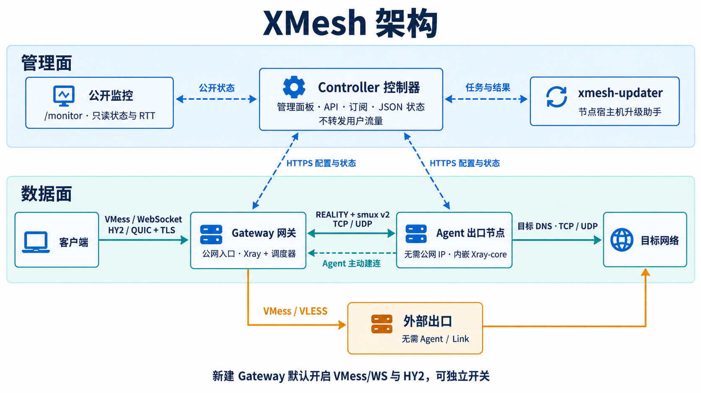
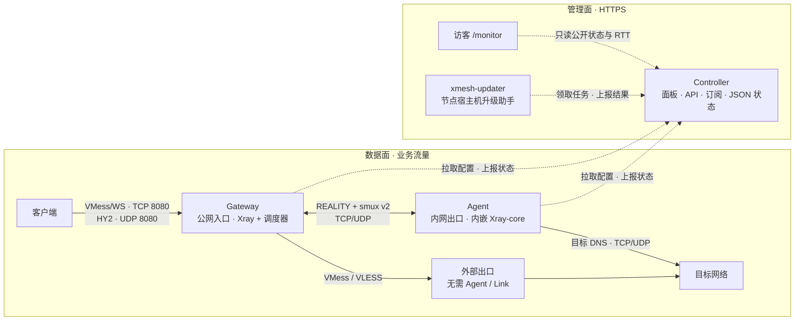

# XMesh

[English](README.en.md) · [公开监控](https://xmesh.static.win7.win/monitor) · [下载 Release](https://github.com/Purestreams/xmesh/releases) · [面板说明](docs/panel.md) · [部署与维护](docs/automation.md)

**让没有公网 IP 的机器成为代理出口。**

XMesh 将客户端入口与实际出口分开：Gateway 提供可访问的入口，Agent 主动从内网向 Gateway 建立隧道，并从自身网络访问目标。Controller 统一管理节点、线路、用户授权和订阅，不参与业务流量转发。

适用于出口机器位于 NAT 后、无法开放入站端口，或需要用多个 Gateway 共享同一个 Agent 出口的场景。Gateway 仍须能被客户端和 Agent 访问；Agent 无需公网 IP 或入站端口映射。

## 公开监控

[打开网络监控界面 →](https://xmesh.static.win7.win/monitor)

免登录查看已发布节点的状态、Gateway × 出口链路矩阵、各条 Link 的往返延迟和近 24 小时趋势。页面每 15 秒刷新，历史约每 5 分钟采样。延迟是 **Gateway ↔ Agent 隧道 RTT**；客户端到入口的延迟和完整代理访问耗时需另外测试。外部线路由对应 Gateway 经指定上游定时访问 ip.sb 和 microsoft.com；公开延迟显示 ip.sb HTTPS 请求耗时，未完成测试时显示“未探测”。

自建 Controller 默认关闭公开监控。在 **系统维护 → 公开监控**（`/admin/monitor`）开启后，逐项选择节点与 Link 并设置公开别名，访客通过 `/monitor` 和专用只读接口 `/api/public/monitor` 查看。公开接口仅输出别名、节点角色、粗粒度状态和 RTT 历史，不输出真实地址、内部身份、凭据、用户、用量或原始错误。配置方法见[公开监控说明](docs/panel.md#anonymous-network-monitor)。

<details>
<summary>监控界面预览（2026-10-13 截图，实时状态以在线页面为准）</summary>

[](https://xmesh.static.win7.win/monitor)

</details>

## 架构一览



<details>
<summary>查看可维护的架构图源码</summary>

图片生成提示词见[架构图片生成记录](docs/assets/architecture-prompts.md)。



</details>

- **客户端接入：** 新建 Gateway 默认同时开启 VMess/WebSocket 和 Hysteria 2（HY2），由同一个 Xray 进程接入并按 Grant 分流；两种协议可独立开关。
- **Agent 出口：** Agent 主动建立 VLESS/REALITY 连接，内部承载 WebSocket + smux v2；Gateway 调度 TCP/UDP 会话到授权 Link，Agent 解析目标 DNS 并建立出口连接。
- **外部出口：** Gateway 也可按用户授权，将客户端流量重新封装为 VMess 或 VLESS 发送到选定的外部节点；这条线路不需要 Agent 或 Link。
- **网络要求：** Gateway 需能被客户端和 Agent 访问，Controller 需能被节点及升级助手访问；Agent 无需公网 IP 或入站端口映射。图中端口为默认值。
- **管理面：** Controller 内嵌管理面板、公开监控、API、订阅和 Release 缓存，以 JSON 状态文件持久化，无需独立前端或数据库；Gateway、Agent 和升级助手主动通过 HTTPS 请求 Controller，Controller 不转发用户流量。

配置更新按影响范围应用：名称等元数据不重建连接，优先级、权重与流容量作用于新会话；隧道地址或凭据变更重建对应 Agent Link，生成的 Gateway Xray 配置变化仍可能重启进程并中断连接。节点配置租约为 5 分钟，无法续期时关闭业务流量。详细行为见[运行边界](docs/deployment.md#runtime-boundaries)和[架构说明](docs/architecture.md)。

客户代理流量默认屏蔽目标 TCP 端口 `25、465、587、2525`，覆盖 VMess/WS、HY2、Agent 和外部出口线路；Agent 端口白名单不能覆盖这条屏蔽规则。规则不限制 UDP 或节点自身的管理、隧道连接。此限制用于减少常见 SMTP 滥用，HTTPS 邮箱、邮件 API 和自定义端口仍可使用。已有部署需升级 Gateway 和 Agent 后生效。

## 当前能力

用户审计默认关闭，可在 **用户与订阅 → 用户审计** 为指定 User 开启。记录 Agent 出口的 DNS 解析和 TCP 连接元数据，按用户统一保存；日志与 gzip 归档合计默认最大 20MB，并显示最近 60 秒的连接、失败、目标和端口异常统计。外部出口未覆盖，异常提示不会自动封禁。见[用户审计说明](docs/panel.md#per-user-audit)。

| 能力 | 说明 |
| --- | --- |
| 统一管理 | 内嵌 Web 面板，包含总览、节点与线路、用户与订阅、部署向导、系统维护；无需单独部署前端 |
| 多入口、多出口 | Gateway 与 Agent 可多对多绑定；支持批量分配及跨节点筛选、开启全部未开启连接 |
| 双协议接入 | VMess/WS 与 HY2 独立开关；HY2 使用持久自签证书、SHA-256 pin 及严格验证客户端包 |
| TCP / UDP 转发 | VMess/WS 或 HY2 接入后按授权选择 Agent 或外部出口；Agent 执行目标 DNS 解析及出口连接，支持允许和拒绝 CIDR |
| REALITY 隧道 | 自动生成 Gateway 密钥和 Link 身份；Agent 内嵌 Xray-core，Gateway 管理随包提供的 Xray 进程 |
| 多链路调度 | 支持优先级、权重、连接数和流容量；新会话选择健康链路，已有会话固定在原隧道上 |
| 用户授权与订阅 | 按用户和线路授权，Gateway 确认对应配置和接入就绪后发布 VMess / HY2 订阅；支持停用授权和重置订阅及代理凭据 |
| 外部出口 | 粘贴单个 `vmess://` 或 `vless://` 链接，或添加订阅 URL 并选择其中一个节点；支持 VMess/TCP、VMess/WS + TLS、VLESS/TCP + REALITY + Vision |
| 部署与维护 | 一次性注册令牌、systemd / Docker Compose 安装命令、Release 缓存、宿主机升级助手及凭据轮换；批量升级等待 Link 恢复后继续 |
| 状态与历史 | 拓扑、Gateway × Agent 矩阵、部署进度、15 秒局部刷新、24 小时链路历史和最近 100 次管理请求结果 |
| 公开监控 | 可选免登录只读页面；按公开别名发布节点、Link 状态与 RTT 历史 |

新建线路使用 `reality://`；已有 `wss://` 链路仍可使用，需要外部 TLS 终止服务。客户端 VMess/WS 默认 TLS 关闭，新建 Gateway 同时默认开启带自签证书和 SHA-256 pin 的 HY2；Gateway–Agent 的 REALITY 加密不等于客户端入口启用了 TLS。当前订阅生成器没有客户端 TLS 配置，不能只加 HTTPS 反向代理就期待订阅自动适配。

## 先理解四个对象

| 对象 | 含义 |
| --- | --- |
| Gateway / Agent | 分别是客户端入口和实际出口，独立安装、独立上报状态 |
| Node / 线路关联（Attachment） | 一个 `Gateway ×（Agent 或外部出口）` 组合，是用户授权与订阅的基本单位 |
| Link | Gateway–Agent 组合下的传输路径；增加 Link 不会增加订阅节点，外部出口没有 Link |
| Grant | 一个 `User × Node` 授权，拥有独立的 VMess UUID、HY2 凭据和本机 SOCKS 凭据 |

同一 Agent 可以主动连接多个 Gateway；同一 Gateway 也可以通过不同线路使用多个 Agent。多 Link 调度作用于新 TCP 连接或 UDP association，不迁移已有会话，也不把单个会话拆到多条链路上。

## 部署

下面以三台独立 Linux 主机分别部署 Controller、Gateway 和 Agent。systemd 安装器支持 Debian/Ubuntu、CentOS 7/8 的 amd64、arm64；CentOS 7 自动使用兼容 systemd 219 的服务配置。Docker 安装器支持 Linux amd64、arm64，需要 Docker Engine 和 Compose 插件，并使用主机网络。Windows amd64 Release 仅提供独立可执行文件，没有 Windows 服务安装器或配套 Xray 包。

同一主机、同一角色选择一种安装方式。systemd 安装器使用固定服务名和目录，Controller 与节点应分开部署。

### 1. 准备网络和安装文件

以下端口对应默认配置：

| 主机 | 地址示例 | 入站端口 | 说明 |
| --- | --- | --- | --- |
| Controller | `panel.example.com` | TCP 80 / 443 | 80 用于下文的 ACME 验证和跳转，443 提供面板、节点 API、订阅及安装文件 |
| Gateway | `edge.example.com` 或公网 IP | TCP 8080 / 8443，UDP 8080 | TCP 8080 是客户端 VMess/WS，UDP 8080 是 HY2；8443 是 Agent REALITY 隧道 |
| Agent | 无需公网地址 | 无需开放入站端口 | 需出站访问 Controller、Gateway，以及代理目标网络 |

Controller `127.0.0.1:8088`、Gateway SOCKS `127.0.0.1:18080` 和隧道后端 `127.0.0.1:18081` 保持本机访问。Gateway 的 REALITY 入口无需为 `edge.example.com` 申请证书，也不需要 Nginx。使用其他公网端口时，需同步调整防火墙、实际监听或端口映射及 Link URL；仅修改 URL 不会修改主机监听端口。

将示例域名替换成自己的地址，并配置 DNS。在三台 Debian/Ubuntu 主机安装基础工具：

```sh
sudo apt update
sudo apt install -y ca-certificates curl tar coreutils
```

CentOS 主机使用以下命令准备基础工具（先确保 yum/dnf 软件源可用），随后运行相同的 systemd 安装命令：

```sh
# CentOS 7
sudo yum install -y ca-certificates curl tar coreutils iproute shadow-utils
# CentOS 8
sudo dnf install -y ca-certificates curl tar coreutils iproute shadow-utils
```

Gateway 如启用 firewalld，需在实际网卡所在 zone 放行 VMess 端口和 REALITY 端口。例如使用 `--vmess-port 8086` 时，放行 TCP 8086 和 8443；Agent 无需开放入站端口。下文 Nginx/Certbot 的包安装和配置路径以 Debian/Ubuntu 为例，CentOS Controller 按本机的软件源、Nginx 布局和 SELinux 策略配置 HTTPS 反向代理。

仅在 Controller 主机安装以下工具并取得源码。本文说明当前代码行为，安装示例固定使用 `v0.4.1`；选择其他已发布版本时，将 `VERSION` 改为对应的精确 tag，源码与安装包使用同一版本。可用版本见 [Releases](https://github.com/Purestreams/xmesh/releases)。

```sh
sudo apt install -y git nginx certbot
VERSION=v0.4.1
git clone --depth 1 --branch "$VERSION" https://github.com/Purestreams/xmesh.git
cd xmesh
```

### 2. 安装 Controller

以下命令在 Controller 主机的 Bash 中运行。Docker 方式需先安装 Docker Engine 和 Compose 插件；两个安装命令只选一个。

```bash
read -rsp '管理密码: ' XMESH_ADMIN_PASSWORD; echo
export XMESH_ADMIN_PASSWORD

# systemd
sudo --preserve-env=XMESH_ADMIN_PASSWORD sh scripts/install-controller.sh \
  --version "$VERSION" --public-url https://panel.example.com

# 或 Docker Compose
# sudo --preserve-env=XMESH_ADMIN_PASSWORD sh scripts/install-docker.sh \
#   --role controller --version "$VERSION" --public-url https://panel.example.com

unset XMESH_ADMIN_PASSWORD
```

默认管理员用户名是 `admin`，可在首次安装时通过 `--admin-username` 指定。安装器下载对应架构的 Release 包并校验 `SHA256SUMS`，生成密码哈希和会话密钥，启动服务后检查健康状态。

### 3. 为 Controller 启用 HTTPS

Controller 自身只提供 HTTP。先建立 ACME 验证站点，在证书申请成功后再启用 HTTPS 配置：

Controller 的 `public_url` 如填写 `http://`，启动日志和管理面板会提示 warning，但不会阻止运行。这个检查只针对对外地址；Nginx 到本机 `127.0.0.1:8088` 的 HTTP 转发不会触发提示。

```sh
DOMAIN=panel.example.com
sudo mkdir -p /var/www/letsencrypt
printf 'server { listen 80; server_name %s; location ^~ /.well-known/acme-challenge/ { root /var/www/letsencrypt; } location / { return 404; } }\n' "$DOMAIN" | sudo tee /etc/nginx/conf.d/xmesh.conf
sudo nginx -t && sudo systemctl reload nginx
sudo certbot certonly --webroot -w /var/www/letsencrypt -d "$DOMAIN"
```

然后将 `/etc/nginx/conf.d/xmesh.conf` 替换为下面的配置，域名和证书路径须与 `--public-url` 一致：

```nginx
server {
    listen 80;
    server_name panel.example.com;
    location ^~ /.well-known/acme-challenge/ { root /var/www/letsencrypt; }
    location / { return 301 https://$host$request_uri; }
}
server {
    listen 443 ssl;
    server_name panel.example.com;
    ssl_certificate /etc/letsencrypt/live/panel.example.com/fullchain.pem;
    ssl_certificate_key /etc/letsencrypt/live/panel.example.com/privkey.pem;

    proxy_set_header Host $host;
    proxy_set_header X-Forwarded-Proto $scheme;
    proxy_set_header X-Real-IP $remote_addr;

    location ^~ /subscription/ {
        access_log off;
        proxy_pass http://127.0.0.1:8088;
    }
    location ^~ /releases/ {
        proxy_read_timeout 600s;
        proxy_buffering off;
        proxy_pass http://127.0.0.1:8088;
    }
    location / {
        proxy_pass http://127.0.0.1:8088;
    }
}
```

`/subscription/` 的 URL 含访问令牌，因此关闭该路径的访问日志；外层代理也应避免记录完整订阅 URL。`/releases/` 首次请求可能等待 Controller 从 GitHub 下载并校验文件，单独延长代理读取超时并关闭响应缓冲。

```sh
sudo nginx -t && sudo systemctl reload nginx
printf '#!/bin/sh\nsystemctl reload nginx\n' | sudo tee /etc/letsencrypt/renewal-hooks/deploy/reload-nginx.sh
sudo chmod 755 /etc/letsencrypt/renewal-hooks/deploy/reload-nginx.sh
sudo certbot renew --dry-run
curl -fsS https://panel.example.com/healthz
```

健康检查应返回 `{"status":"ok"}`。访问 `https://panel.example.com/login` 登录面板。

### 4. 在部署向导创建线路

第一次部署可以使用 **Create route**，一次创建 Gateway、Agent、Node 关联和 Link：

| 字段 | 示例或含义 |
| --- | --- |
| Gateway public host | `edge.example.com`，也可填写公网 IP，不带协议或路径 |
| Gateway 所在地 | 管理员选择中国国内或境外，用于新 REALITY target 的默认值 |
| VMess port / WS path | 默认 `8080` / `/proxy`，供客户端连接 |
| Agent allowed / denied CIDRs | 限制实际出口可访问的目标地址；默认允许 `0.0.0.0/0, ::/0`，按需要收窄范围或设置拒绝项 |
| Agent → Gateway Link URL | `reality://edge.example.com:8443/tunnel`，供 Agent 建连 |
| REALITY target | Gateway 可访问的 TLS 目标，格式必须是 DNS 主机名加 `:443` |

选择中国国内时，新 target 默认是 `api.bilibili.com:443`；境外默认是 `www.swift.com:443`。这只是配置默认值，不代表在当前网络中已验证可用，部署时仍需检查目标的 TLS 1.3 和证书域名。未选择地区且没有已有 target 时，必须手工填写。Link URL 的 Gateway 地址与 target 的 TLS 名称是不同字段。

每个 Gateway 共用一组 REALITY 密钥和 target，每个 Link 有独立 VLESS UUID 和 short ID，由 Controller 生成。**修改 Gateway 所在地不会替换已有 target**；在 Link 编辑页主动修改共享 target 会影响该 Gateway 下的所有 REALITY 链路。

已有节点可在“节点与线路”分别创建，再通过 **Assign multiple Gateways to an Agent** 批量绑定。缺失的关联和 Link 会一起创建，已停用的线路会重新启用，已启用的线路保持原样。混合地区批量绑定时，空 target 按各 Gateway 地区取默认值，已有 target 优先保留。

在 **连接已有节点 → 全部未开启连接** 中，可跨 Agent / Gateway 筛选未建立、已停用或缺少 Link 的组合，选择后一次性开启；已开启的组合即使离线也不会重复列入。操作保留已有 target 和 Link 设置，用户授权仍需单独开通。

### 5. 安装 Gateway 和 Agent

分别点击 **Install Gateway**、**Install Agent**，选择 systemd 或 Docker Compose，将面板生成的命令复制到对应主机执行，并在提示时输入该节点的一次性令牌。节点主机无需克隆仓库。

- 令牌 30 分钟有效、只能使用一次；为同一节点生成新令牌会撤销之前未使用的令牌。
- 可选 GitHub 直连或 Controller 缓存下载。缓存方式仍要求 Controller 能访问 GitHub，文件校验成功后才会写入缓存。
- 生成的命令固定版本并校验安装脚本；安装器再校验二进制包。非默认 VMess 端口会通过 `--vmess-port` 传入安装器检查。
- 面板生成命令，但不通过 SSH 远程执行安装。Docker 方式使用主机网络，不需要额外 Compose 端口映射。

查看部署进度，依次确认注册、心跳、配置应用和运行状态。仅有 `online` 不代表线路已经可以使用。

### 6. 授权并导入订阅

新建 Gateway 默认同时开启 **VMess/WS 和 HY2**，可在 Gateway 列表或编辑表单中独立关闭任一协议。关闭后移除对应监听和订阅项，重新开启保留授权、证书及 pin；两种都关闭时 Agent 隧道仍保留。已有 Gateway 保持原设置。多个用户和线路共用一个 UDP 端口，每个 Grant 使用独立凭据；端口号可与 VMess 相同，例如 TCP/UDP 8080。HY2 使用持久自签证书及 SHA-256 pin，未认证的 HTTP/3 请求固定返回 404，不代理 REALITY target 或任何原网站。严格验证客户端包、UDP 防火墙和验收方式见 [HY2 接入](docs/hy2.md)。

在“用户与订阅”创建 User，然后在订阅授权表单选择用户及允许使用的线路。操作会新增或重新启用 Grant；清除勾选只清空当前选择，撤销访问需单独停用或删除 Grant。

Gateway 报告对应配置已应用且相应接入就绪后，授权才会发布。复制面板中的订阅 URL，导入支持对应协议的客户端。订阅是 Base64 编码的 `vmess://` 和 `hysteria2://` 列表，仅包含已开启且就绪的接入；VMess 客户端连接 `edge.example.com:8080/proxy`，HY2 使用 UDP 8080，Agent 隧道使用 TCP 8443。官方 Hysteria 客户端需从授权管理下载严格验证客户端包，配置公开证书与 pin，详见 [HY2 接入](docs/hy2.md)。

**订阅发布不等于线路健康检查通过。** Agent 线路验收需确认两端在线、配置已应用、Gateway Xray 就绪，且同一个已启用 Link 在 Gateway 和 Agent 两端均报告 ready，最后实际测试目标访问。外部出口需确认 Gateway 配置已应用，并实际测试上游与目标连通性。

外部出口在“节点与线路 → 外部出口”添加，支持 `vmess://`（TCP 或 WS，可带 TLS）和 `vless://`（TCP + REALITY + Vision）链接。无法准确表示的 VMess 选项会在导入时被拒绝。订阅 URL 包含多个节点时，先明确选择一个，再绑定 Gateway 并为用户开通该线路。Controller 每 30 分钟刷新订阅，也可手动刷新；拉取失败时保留上次有效配置，已选节点在成功刷新后消失时会关闭该出口，不能自动切换到其他节点。旧版 Gateway 须升级到支持外部出口的版本，授权才能发布。Gateway 应用配置后自动测试，并默认每 60 秒经所选上游测试 ip.sb 和 microsoft.com；连续失败超过 5 分钟的线路会从用户订阅中隐藏，测试恢复成功后自动重新出现。页面提供“测试连接”按钮及两站结果、HTTPS 耗时、出口 IP 和失败原因。测试与用户授权无关，不计入用户流量，手动测试不重启 Xray。Controller 与 Gateway 均需升级以支持测试。订阅 URL 和上游 UUID 不出现在给用户的订阅中。公网订阅 URL 才能自动抓取；内网订阅仅可通过 Controller 配置的 `allow_private_upstream_sources` 显式放行。

## 日常维护

### 配置、状态和日志

| 部署方式 | 配置 | 状态 / 数据 | 日志 |
| --- | --- | --- | --- |
| systemd Controller | `/etc/xmesh/controller.json` | `/var/lib/xmesh-controller/` | `sudo journalctl -u xmesh-controller -f` |
| systemd Gateway / Agent | `/etc/xmesh/node.json` | `/var/lib/xmesh/` | `sudo journalctl -u xmesh -f` |
| Docker（默认目录） | `/opt/xmesh-docker-<role>/config/` | `/opt/xmesh-docker-<role>/data/` | 在对应安装目录执行 `sudo docker compose logs -f` |

Controller 状态保存在 `controller-state.json`，不需要额外数据库。配置、状态和备份包含凭据或私钥，应限制读取权限。不要提交这些文件、注册令牌或订阅 URL。

面板每 15 秒局部刷新并保留正在输入的内容。链路历史来自 Gateway 上报，最多每 5 分钟采样一次，保留最近 24 小时；重启、计数回退或采样间隔过长时吞吐曲线留空。用户与订阅页面按用户展示近 5 小时、1 天、7 天和 30 天的上传/下载用量，并可展开查看每条 Link。计数由 Gateway 按实际选中的 Link 记录 TCP/UDP 有效载荷；旧版数据没有 Link 归属，因此升级后才开始积累，按 5 分钟桶统计，最近 30 天保留。最近 100 次管理请求结果随状态文件保存；升级请求被接受与升级完成会分别显示。

### 升级、轮换与备份

v0.3.3 Release 包含 `xmesh-updater`，可由面板下发节点升级。v0.3.2 没有该助手；从旧版本迁移时先升级 Controller，再为旧节点安装助手。

- **先升级 Controller，再升级 Gateway / Agent。** Controller 安装器保留既有配置并更新 `release_version`；不要假设再次传入 `--public-url` 或管理密码会覆盖原配置。旧配置缺少 `release_dir` 时需手工补齐并重启，才能启用缓存。
- Docker Controller 在宿主机具备 systemd、`flock`、`sort` 和升级助手时，可在面板检查 GitHub 最新正式版并升级。助手在宿主机校验、备份和执行升级，Controller 容器不挂载 Docker socket。旧安装需先在宿主机运行支持该助手的 Docker 安装器。
- systemd Controller 通过对应版本的 `install-controller.sh` 升级。Gateway / Agent 新安装会在宿主机配置独立的 `xmesh-updater` 服务；在 **系统维护 → 节点升级** 选择固定版本和节点即可下发任务。助手主动领取，校验安装包，验收新进程及配置，失败时恢复旧版本。批量任务串行执行，线路退化时暂停。
- 每个节点升级成功后，批次进入 `recovering`，最多等待 2 分钟，确认此前健康 Link 的 Gateway 和 Agent 均在升级完成后重新报告在线、就绪，再放行下一任务。超时暂停后，修复链路并点击 **重新检查并继续**，通过复核即可继续余下任务，已成功升级的节点无需重做。
- 老节点先在 **节点升级** 中生成一次性助手配对令牌，在节点宿主机执行面板提供的 `install-updater.sh` 命令；命令已包含一次性令牌，无需再手动输入，并保留节点身份。复制的命令包含敏感令牌，使用后应清理 shell 历史。已配对节点的手动升级命令也调用同一助手执行器；未迁移节点仍使用原安装器。Docker 节点的助手运行在宿主机，要求宿主机有 systemd；业务容器不挂载 Docker socket。
- 助手升级记录保存在 Controller 状态文件，宿主机上的任务记录和回滚材料保存在 `/var/lib/xmesh-updater/jobs`（systemd）或安装目录的 `updater/jobs`（Docker）。备份和清理时保留未完成任务的记录。
- 节点凭据轮换使用新注册令牌和面板的 **rotate** 命令，保留节点身份。旧凭据最多有 15 分钟宽限期，新凭据首次上报后立即撤销旧凭据。订阅泄露时使用 **Reset link**：旧 URL 立即失效，并轮换该用户所有线路的 VMess、HY2 和 SOCKS 凭据；Gateway 应用后撤销旧代理凭据，客户端需重新导入订阅。
- 删除面板中的 Gateway / Agent 会删除相关管理对象，但不会远程卸载主机服务；停用和卸载需在对应主机处理。

Docker Controller 可在匹配版本的源码目录执行：

```sh
sudo sh scripts/backup-controller.sh \
  /opt/xmesh-docker-controller /var/backups/xmesh-controller
```

该脚本备份配置及已有状态文件，解包核对并生成 SHA-256 校验文件。将备份与校验文件一同保存到其他主机。systemd 部署需备份上表中的配置和状态文件；恢复为手工流程，应先在隔离环境验证。详细流程见[部署自动化](docs/automation.md)。

### 排障顺序

| 现象 | 优先检查 |
| --- | --- |
| 安装或注册失败 | Controller HTTPS `/healthz`、系统时间、令牌是否过期或已被替换；非默认 Gateway 端口应使用重新生成的命令 |
| 节点在线但线路未就绪 | 两端 desired / applied 配置、ApplyError、Gateway Xray 状态、同一 Link 两端状态 |
| REALITY Link 无法建立 | Gateway TCP 8443、防火墙/映射、Link URL 与实际监听、Gateway 到 target 的连通性 |
| 订阅为空或未出现新线路 | User / Grant / Node 与接入协议是否启用、Gateway 是否已确认新配置及相应接入就绪；Agent 线路还需启用的 Link |
| 订阅有节点但目标访问失败 | 实际 Link 健康、Agent 出站网络、DNS 和 CIDR 策略 |
| 安装文件缓存返回错误 | Controller 的 GitHub 访问、`release_version` / `release_dir`、磁盘空间与反向代理超时；必要时选 GitHub 直连命令 |
| 高 RTT 下吞吐不足 | 主机 TCP 缓冲区及链路的写阻塞、容量和拒绝计数；见[高延迟链路](docs/deployment.md#high-latency-links) |

## 开发与验证

项目使用 Go，`mise.toml` 固定 Go **1.27.2**；Gateway 外部 Xray 版本由 `versions.env` 固定，Agent 内嵌 Xray-core 依赖在 `go.mod` 中管理。

```sh
mise install
mise exec -- go test ./...
mise exec -- go vet ./...
mise exec -- go build -o bin/xmesh ./cmd/xmesh
mise exec -- go build -o bin/xmesh-updater ./cmd/xmesh-updater
node --test tests/panel.test.cjs
```

Node.js 用于面板测试，不是生产运行依赖。真实浏览器回归需要 Playwright，步骤见[面板验证](docs/panel.md#verification)。Docker 多容器端到端验证需要 Docker 和 PowerShell：

```sh
pwsh tests/reality/multicontainer.ps1
```

该测试启动 Controller、两个 Gateway、Agent、VMess 与官方 HY2 客户端及目标服务容器，检查经 REALITY 路由的 TCP/UDP 回显、严格证书验证和用量。完整 CI 还用真实 Docker Compose 容器验证节点升级与自动回滚，并检查安装器、迁移脚本和 Controller 升级助手，见 [CI 配置](.github/workflows/ci.yml)。

| 目录 / 文档 | 内容 |
| --- | --- |
| `cmd/xmesh/` | Controller、Gateway、Agent 及注册/密钥工具的统一入口 |
| `internal/controller/` | 管理面板、公开监控、API、订阅、部署编排和 Release 缓存 |
| `internal/gateway/`、`internal/agent/` | 客户端接入、隧道、出口连接和访问策略 |
| `internal/protocol/`、`internal/scheduler/` | 帧协议、smux 会话和链路选择 |
| `cmd/xmesh-updater/`、`internal/updater/` | 宿主机升级助手、任务执行、验收与回滚 |
| `internal/hy2/` | HY2 证书生成、校验与 pin |
| `configs/`、`scripts/`、`tests/` | 配置模板、安装/打包脚本及回归验证；模板中的占位值须替换 |
| [面板说明](docs/panel.md) | 向导、批量选择、刷新、历史和浏览器验证 |
| [部署自动化](docs/automation.md) | 安装、授权、升级、凭据轮换和备份 |
| [部署细节](docs/deployment.md) | 手工配置、Release 缓存及网络调优 |
| [架构说明](docs/architecture.md) | 授权模型、调度与 TCP/UDP 传输 |
| [HY2 接入](docs/hy2.md) | 双协议开关、严格证书验证、客户端包及 UDP 部署 |

## 许可证

XMesh 使用 [MIT License](LICENSE)。随发行包提供或使用的第三方组件许可见 [THIRD_PARTY_NOTICES.md](THIRD_PARTY_NOTICES.md)。
